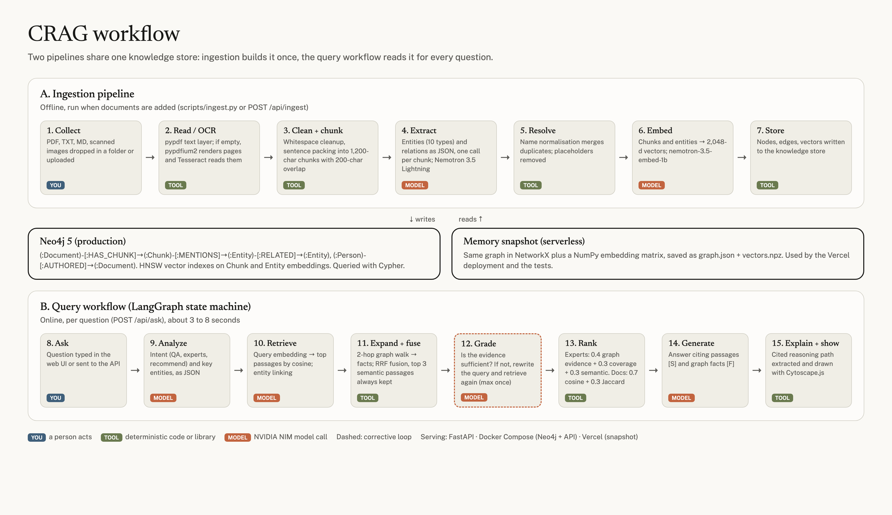
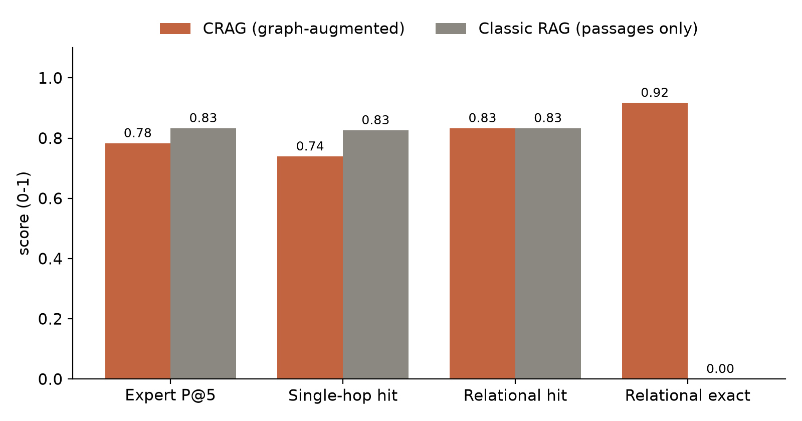

# CRAG

**A knowledge-graph-augmented LLM platform for enterprise knowledge management.**

CRAG turns company documents into a knowledge graph with a large language model, then answers natural-language questions by combining that graph with semantic passage retrieval. Every answer cites the passages `[S#]` and graph facts `[F#]` it relies on, and the cited facts are drawn as a reasoning path. The same graph identifies the experts of a domain and recommends similar documents.

Final-year project (PFE), Master in Data Science and Engineering (MDSE), Ecole Hassania des Travaux Publics, 2025/2026. Author: Daoudi Ahmed Khalil. Supervisor: Dr. Abdelali El Bouchti.



## What it does

| Capability | How |
|---|---|
| Collect knowledge, including scanned documents | pypdf text layer; Tesseract OCR (pages rendered with pypdfium2) when a PDF has no usable text |
| Build a knowledge graph | One LLM call per chunk extracts entities (10 types) and typed relations as JSON, validated in code |
| Answer complex questions | LangGraph workflow: intent analysis → vector + graph retrieval fused with Reciprocal Rank Fusion → evidence grading with one corrective retry → cited generation |
| Explain answers from the graph | The facts the answer cites form its reasoning path, drawn in the UI |
| Identify experts | 0.4 graph evidence + 0.3 coverage of the question's entities + 0.3 semantic similarity |
| Recommend similar documents | 0.7 embedding similarity + 0.3 Jaccard overlap of graph entities |
| Visualise relations | Interactive graph (Cytoscape.js) |
| Compare with classic RAG | `mode: "vector"` runs the same pipeline with the graph steps off |

Who performs each step (you, a tool or the model) and with which technology: [docs/pipeline_roles.png](docs/pipeline_roles.png). Every term used: [docs/keywords.png](docs/keywords.png).

## Architecture

```
crag/
  config.py     settings from environment variables
  llm.py        NVIDIA NIM client: chat (Nemotron 3.5 Lightning 30B-A3B) and embeddings (Nemotron 3.5 Embed 1B)
  ingest.py     load + OCR, clean, chunk (1,200 chars / 200 overlap), LLM extraction, entity resolution
  store.py      graph + vector store: Neo4jStore (production) and MemoryStore (NetworkX + NumPy snapshot)
  workflow.py   LangGraph state machine: analyze → retrieve → grade → experts | recommend → generate → explain
  api.py        FastAPI REST API + static web UI
web/            interface (HTML, CSS, JavaScript, Cytoscape.js)
scripts/        ingest.py, evaluate.py, prepare_testdata.py
tests/          offline tests (models replaced by deterministic fakes)
docs/           diagrams, evaluation charts, course and step-by-step explanation
```

Graph model:

```
(:Document)-[:HAS_CHUNK]->(:Chunk {text, embedding})-[:MENTIONS]->(:Entity {name, type, embedding})
(:Entity)-[:RELATED {type, description, doc_id}]->(:Entity)
(:Entity {type:'Person'})-[:AUTHORED]->(:Document)
```

Neo4j stores the graph and two cosine HNSW vector indexes (chunks and entities). The memory backend holds the same data in two files and serves the read-only public demo and the tests.

## Run it

Requirements: Python 3.12+, an NVIDIA API key (build.nvidia.com), Docker for the Neo4j stack, Tesseract for scanned documents.

```bash
python3 -m venv .venv && source .venv/bin/activate
pip install -r requirements-dev.txt
cp .env.example .env        # add NVIDIA_API_KEY, NEO4J_PASSWORD, CRAG_ADMIN_TOKEN
```

Ingest a folder of documents (memory backend), then serve:

```bash
python scripts/ingest.py /path/to/documents
uvicorn crag.api:app --port 8080      # http://localhost:8080, API docs at /docs
```

Production stack with Neo4j:

```bash
docker compose up -d                  # Neo4j on 7474/7687, CRAG on 8080
docker compose exec crag python scripts/ingest.py --to-neo4j   # or upload through POST /api/ingest
```

Tests and evaluation:

```bash
pytest -q                             # 11 offline tests
python scripts/evaluate.py            # CRAG vs classic RAG, writes data/eval/ and docs/eval/
```

## API

| Method | Route | Purpose |
|---|---|---|
| GET | `/api/health`, `/api/stats` | Status, models, graph size |
| POST | `/api/ask` | `{"question": "...", "mode": "graph" or "vector"}` → answer, sources, facts, graph, experts, recommendations, trace |
| GET | `/api/experts?topic=` | Ranked experts |
| GET | `/api/recommend?doc_id=` | Similar documents |
| GET | `/api/graph?limit=`, `/api/documents` | Graph view, document list |
| POST | `/api/ingest` | Upload a document (header `X-Admin-Token`; disabled when `CRAG_READ_ONLY=1`) |

Protections: Pydantic validation, upload allow-list and 20 MB cap, admin token, 20 model-backed requests per minute per IP, HTML escaping of all document and model text, non-root container.

## Evaluation

CRAG was compared with a classic RAG baseline: the same models, chunks and prompts with the graph steps switched off. The test corpus (38 anonymised public profile documents, 2 of them scanned) was used only for validation and is not distributed in this repository.

{{RESULTS_TABLE}}

Two iterations were run. The first exposed three flaws in the evaluation setup and one design flaw (degree bias in expert ranking). The second run uses the fixed version. The fixes were designed after seeing the first results on the same questions, so second-run numbers are optimistic. Details are in the report and in [docs/CRAG_DETAILS.txt](docs/CRAG_DETAILS.txt).



## Documentation

- [docs/CRAG_DETAILS.txt](docs/CRAG_DETAILS.txt): every step of the project explained from first principles
- [docs/CRAG_Course_From_Zero_to_100.pdf](docs/CRAG_Course_From_Zero_to_100.pdf): a full course on everything used here
- [OTHER_IDEAS.md](OTHER_IDEAS.md): 37 improvements that could be committed next

## Limits

Test documents are public profiles, not company documents; the evaluation set is small; extraction quality is not measured directly; synonyms are not merged; the scoring weights were set by hand; documents are sent to a hosted model API (NVIDIA NIM can be self-hosted with the same interface). See OTHER_IDEAS.md for the fixes.
