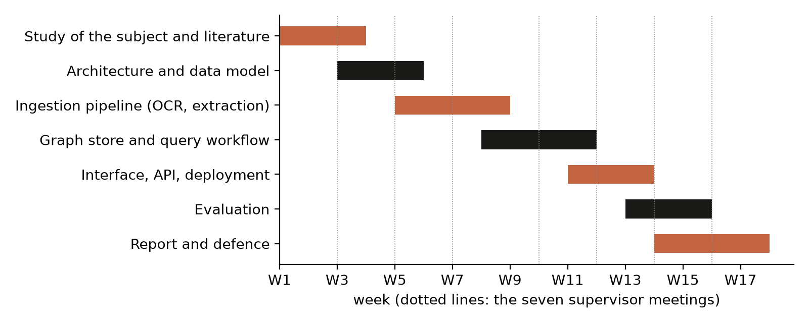
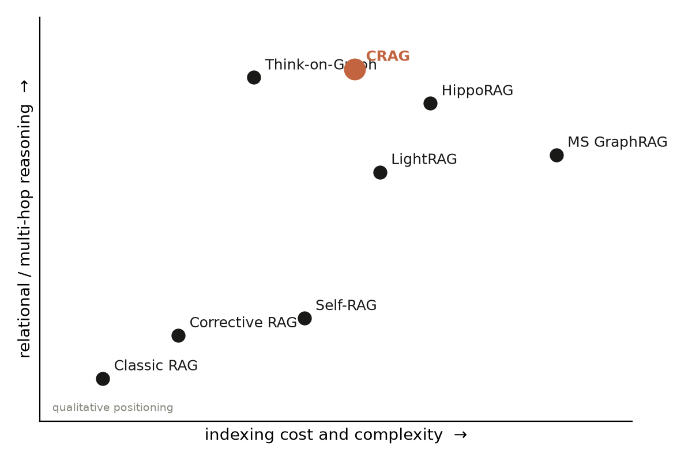
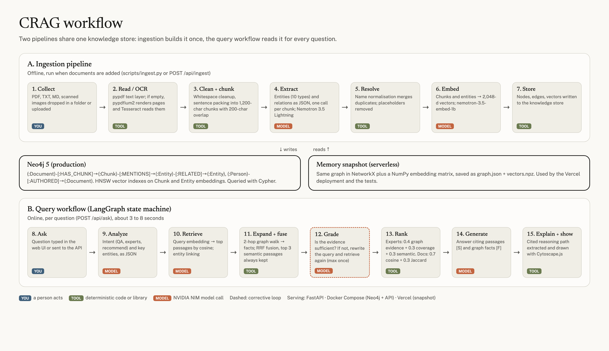
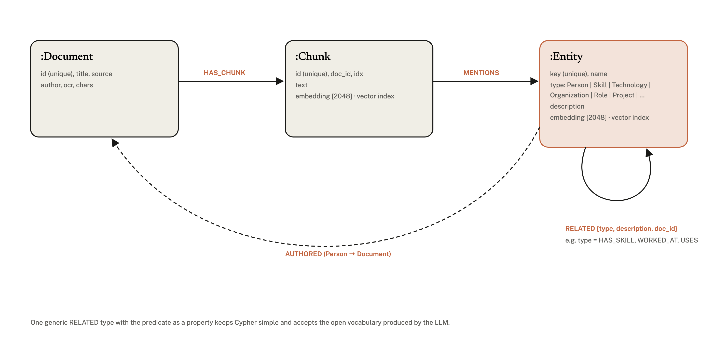
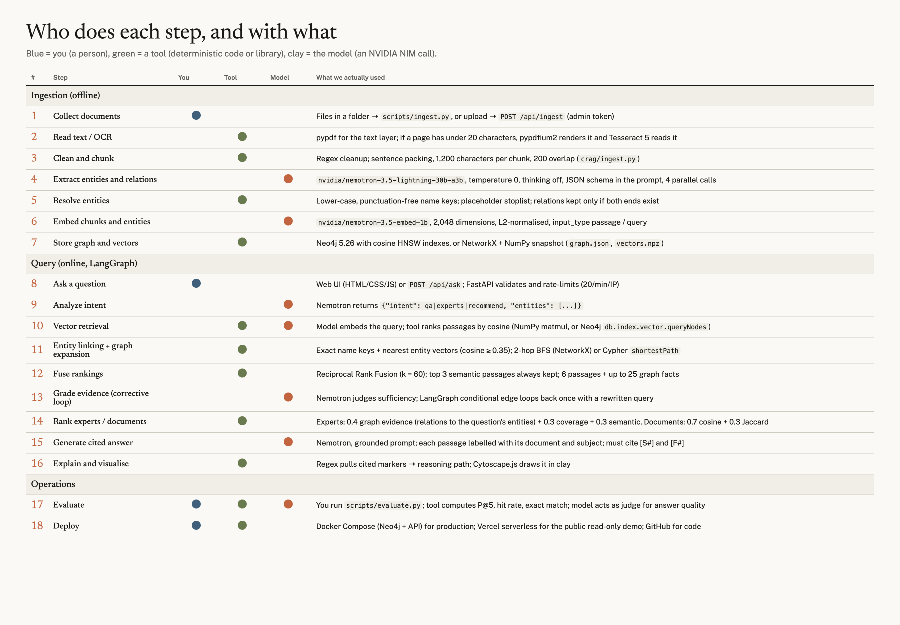
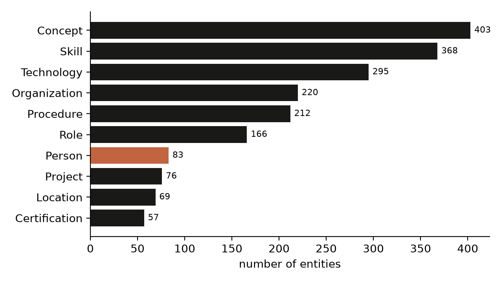
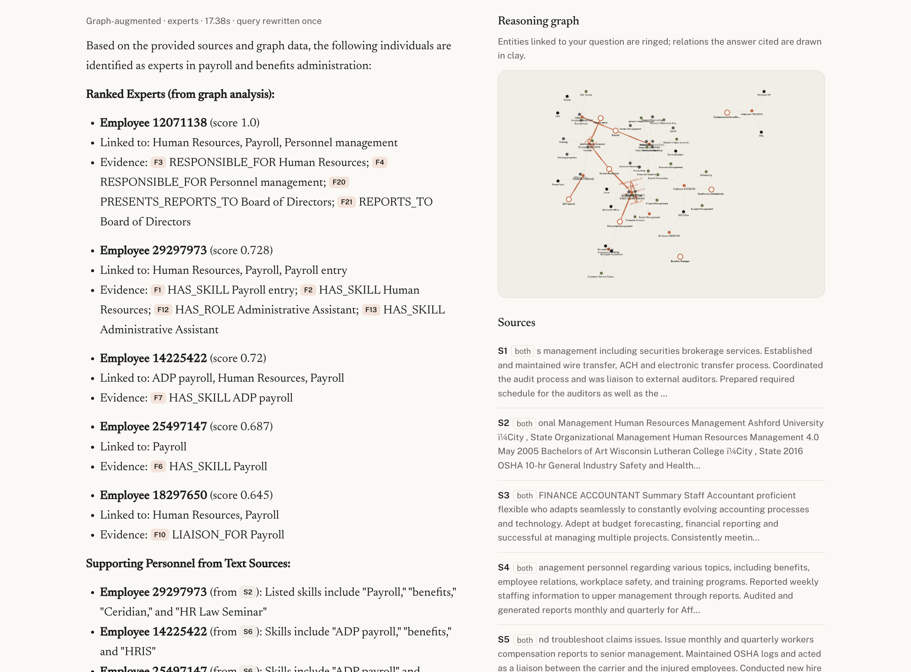
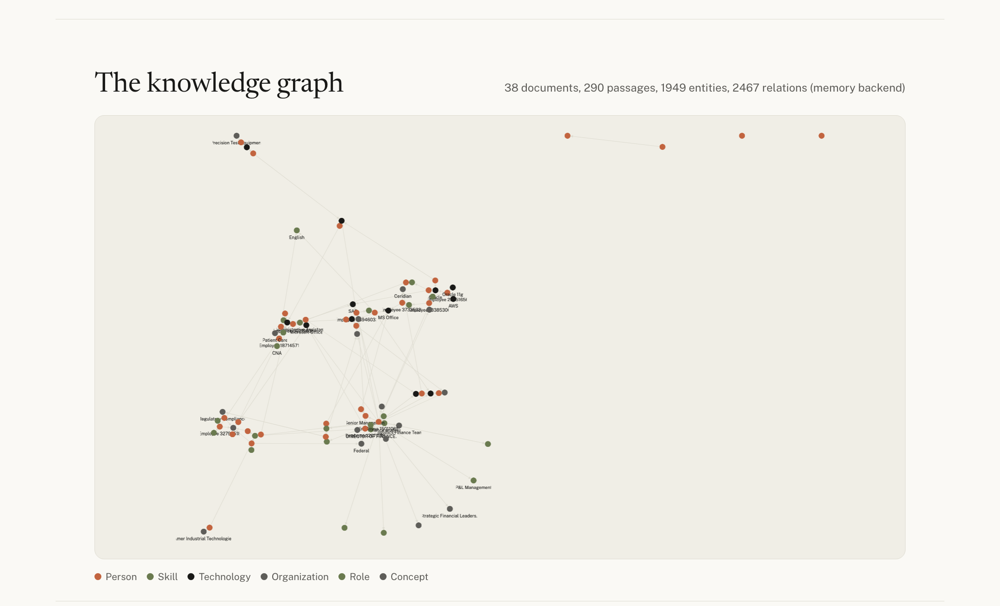

# Acknowledgements

I would like to express my sincere gratitude to my supervisor, **Dr. Abdelali El Bouchti**, for his guidance, his availability and the rigour of his feedback throughout this project. His questions pushed me to justify each design decision and to measure, rather than assume, what the knowledge graph adds.

I also thank the professors of the **Master in Data Science and Engineering (MDSE)** at the **Ecole Hassania des Travaux Publics** for the training that made this work possible, and the members of the jury for the time they devote to evaluating it.

Finally, I thank my family and friends for their constant support.

# Abstract

Enterprises accumulate knowledge in large, heterogeneous document collections, but retrieving it remains difficult: keyword search returns documents rather than answers, and Retrieval-Augmented Generation (RAG) systems, which ground a Large Language Model (LLM) in retrieved passages, treat those passages independently and therefore struggle with questions that depend on relations between facts spread over several documents.

This project presents **CRAG**, an intelligent knowledge management platform that combines a **knowledge graph** with an LLM. CRAG ingests documents (including scanned ones, through OCR), uses an LLM to extract entities and typed relations into a **Neo4j** property graph that also holds dense vector indexes, and answers natural-language questions with a **LangGraph** workflow that fuses semantic passage retrieval with multi-hop graph expansion, grades its own evidence and retries when the evidence is weak, and generates answers that cite both passages and graph facts. From those citations the platform derives an explanation of each answer as a path in the graph. The same machinery identifies the experts of a domain and recommends similar documents. A web interface visualises the graph and the reasoning path of every answer. The platform is containerised with Docker and deployed publicly.

CRAG was evaluated against a classic passages-only RAG baseline that shares the same models and chunks. On a validation corpus, graph augmentation improved expert-finding precision and relational question answering while keeping single-hop answer quality comparable (Chapter 5).

**Keywords:** knowledge graph, large language model, retrieval-augmented generation, GraphRAG, Neo4j, LangGraph, expert finding, knowledge management.

# Résumé

Les entreprises accumulent leurs connaissances dans de vastes collections documentaires hétérogènes, mais leur exploitation reste difficile : la recherche par mots-clés renvoie des documents plutôt que des réponses, et les systèmes de génération augmentée par la recherche (RAG), qui ancrent un grand modèle de langage (LLM) dans des passages retrouvés, traitent ces passages de manière indépendante. Ils peinent donc sur les questions qui dépendent de relations entre des faits répartis dans plusieurs documents.

Ce projet présente **CRAG**, une plateforme intelligente de gestion des connaissances qui associe un **graphe de connaissances** à un LLM. CRAG ingère des documents (y compris numérisés, grâce à l'OCR), utilise un LLM pour en extraire des entités et des relations typées dans un graphe **Neo4j** qui contient aussi des index vectoriels, et répond aux questions en langage naturel grâce à un workflow **LangGraph** qui fusionne la recherche sémantique de passages et l'expansion multi-sauts dans le graphe, évalue la qualité de ses preuves et relance la recherche si nécessaire, puis génère des réponses citant passages et faits du graphe. Ces citations permettent d'expliquer chaque réponse par un chemin dans le graphe. Le même mécanisme identifie les experts d'un domaine et recommande des documents similaires. Une interface web visualise le graphe et le raisonnement de chaque réponse. La plateforme est conteneurisée avec Docker et déployée en ligne.

Comparé à un RAG classique utilisant les mêmes modèles, CRAG améliore la précision de l'identification d'experts et la réponse aux questions relationnelles, tout en conservant une qualité comparable sur les questions simples (chapitre 5).

**Mots-clés :** graphe de connaissances, grand modèle de langage, RAG, GraphRAG, Neo4j, LangGraph, identification d'experts, gestion des connaissances.

# Table of contents

[[TOC]]

# List of figures and tables

**Figures**

- Figure 1.1: Project planning (Gantt chart)
- Figure 2.1: Positioning of CRAG among RAG and GraphRAG approaches
- Figure 3.1: Overall workflow of the CRAG platform
- Figure 3.2: Graph data model
- Figure 3.3: Steps, actors and technologies of the pipeline
- Figure 4.1: Distribution of extracted entity types
- Figure 4.2: The question-answering interface
- Figure 4.3: The knowledge graph explorer
- Figure 5.1: Retrieval and identification results, CRAG versus classic RAG
- Figure 5.2: Answer quality judged by an LLM
- Figure 5.3: Mean latency per question

**Tables**

- Table 2.1: Comparison of RAG and graph-based RAG approaches
- Table 3.1: Functional requirements
- Table 3.2: Non-functional requirements
- Table 3.3: Technology choices and justification
- Table 4.1: Prompts used by the platform
- Table 4.2: REST API of the platform
- Table 4.3: Security measures
- Table 5.1: Evaluation benchmarks
- Table 5.2: Main results

# Abbreviations

| Abbreviation | Meaning |
|---|---|
| API | Application Programming Interface |
| BFS | Breadth-First Search |
| GraphRAG | Graph-based Retrieval-Augmented Generation |
| HNSW | Hierarchical Navigable Small World (vector index) |
| JSON | JavaScript Object Notation |
| KG | Knowledge Graph |
| LLM | Large Language Model |
| MoE | Mixture of Experts |
| NIM | NVIDIA Inference Microservice |
| OCR | Optical Character Recognition |
| P@5 | Precision at rank 5 |
| RAG | Retrieval-Augmented Generation |
| REST | Representational State Transfer |
| RRF | Reciprocal Rank Fusion |
| UI | User Interface |

# General introduction

Knowledge is one of the main assets of a modern organisation. Nonaka and Takeuchi distinguish the *explicit* knowledge written in documents from the *tacit* knowledge held by people [28]. Both are hard to exploit at scale: explicit knowledge is scattered across thousands of reports, procedures and project files, and tacit knowledge is only reachable if one knows *who* holds it. The cost is familiar to any engineer: time spent searching, work duplicated because a similar project was not found, and experts who are not consulted because nobody knew they existed.

Large Language Models (LLMs) changed what can be expected from a search system. They understand questions in natural language and write fluent answers. On their own, however, they ignore private company documents, and they can produce confident but false statements ("hallucinations"). **Retrieval-Augmented Generation (RAG)** [2] addresses both problems by retrieving relevant passages and asking the model to answer from them. RAG has become the standard architecture of enterprise assistants [3].

Classic RAG retrieves passages *independently*, by their similarity to the question. Many valuable questions are *relational*: *who has worked on both X and Y?*, *which procedures concern the equipment used in this project?*, *who are the experts of this domain?* The answer is not in any single passage; it lies in the links between facts. **Knowledge graphs** [8] represent exactly such links, as entities connected by typed relations, and recent work on **GraphRAG** [11], [12] shows how an LLM can both build a graph from text and use it at query time.

This final-year project, entitled *Knowledge Graph + LLM*, aims to build an intelligent knowledge-management platform, named **CRAG**, that collects company knowledge, builds a knowledge graph, identifies relations between concepts, answers complex questions in natural language, explains its answers from the graph, identifies the experts of a domain, recommends similar documents and visualises the relations between concepts. As the brief requires, it exploits the relations between pieces of knowledge to improve on a classic RAG system, and the improvement is measured, not assumed.

The report is organised in five chapters. Chapter 1 presents the context, the problem and the objectives. Chapter 2 reviews the state of the art on LLMs, RAG and knowledge graphs, and positions CRAG. Chapter 3 details the analysis and the design: requirements, architecture, data model and workflow. Chapter 4 describes the implementation and the deployment. Chapter 5 evaluates CRAG against a classic RAG baseline and discusses the results and their limits. A general conclusion summarises the contributions and the perspectives.

# Context and problem statement

## Context

The project was carried out as the final-year project (Projet de Fin d'Études) of the Master in Data Science and Engineering (MDSE) at the Ecole Hassania des Travaux Publics (EHTP), during the academic year 2025/2026, under the supervision of Dr. Abdelali El Bouchti. Its subject, *Knowledge Graph + LLM*, asks for an intelligent knowledge-management platform built on a knowledge graph enriched by an LLM, using LLMs, RAG, LangGraph, GraphRAG, OCR, Neo4j and Docker, applied to company documents.

## Problem statement

An organisation's documents contain three kinds of knowledge that matter to an employee looking for information:

1. **Facts** stated in one place ("the maintenance procedure requires two signatures").
2. **Relations** spread across documents ("this engineer used this software on that project").
3. **People**: who knows what, which is rarely written explicitly and has to be inferred from the documents people wrote or appear in.

Keyword search finds only the first kind, and only when the words match. Classic RAG adds semantic matching and natural-language answers, but it remains passage-centred: the retriever scores each passage alone against the question. When the answer requires combining facts from several passages, or reasoning about people and their skills, the most relevant passages are often not the most *similar* ones, and the LLM receives incomplete evidence. Moreover, a RAG answer can cite passages but cannot show *how* the facts connect.

The research question of this project is therefore:

> *Can an LLM-built knowledge graph, combined with semantic retrieval in a single workflow, answer enterprise questions better than classic RAG, especially relational and expert-finding questions, while explaining its answers?*

## Objectives

The functional objectives follow the brief. The platform must:

- **O1** extract knowledge automatically from documents, including scanned ones;
- **O2** build a knowledge graph automatically;
- **O3** identify the relations between concepts;
- **O4** answer complex questions in natural language;
- **O5** explain its answers from the graph;
- **O6** identify the experts of a domain;
- **O7** recommend similar documents, procedures or projects;
- **O8** visualise the relations between concepts.

Two further objectives make the work verifiable and usable:

- **O9** measure the gain over a classic RAG system on the same data and models;
- **O10** be production-ready: containerised, secured, tested, documented and deployed.

## Scope and constraints

- **Data.** No company documents were available during the project. The platform is document-agnostic; a public corpus of anonymised professional-profile documents was used *only* to test and evaluate it. Such profiles contain people, skills, roles, tools and projects, which are the knowledge types the expert-finding objective needs.
- **Hardware.** Development was done on a laptop with 8 GB of memory, which cannot host a useful LLM. Models are therefore accessed through the NVIDIA NIM API.
- **Language.** The interface and the documentation are in English; the models can answer in the language of the question.

## Methodology and planning

The work followed an iterative method in six phases: (1) study of the subject and the literature; (2) design of the architecture and the data model; (3) implementation of the ingestion pipeline; (4) implementation of the graph store and the query workflow; (5) interface, API and deployment; (6) evaluation and writing. Each phase ended with a working increment that was presented to the supervisor, and feedback was integrated in the next phase. Figure 1.1 shows the planning.

<figure><figcaption>Figure 1.1: Project planning (Gantt chart, in weeks)</figcaption></figure>

# State of the art

## Large Language Models

An LLM is a neural network, almost always a *Transformer* [1], trained to predict the next token of a text. Its attention mechanism lets each token weigh every other token of the input. Trained on trillions of tokens, such models acquire grammar, world knowledge and a degree of reasoning, and can follow instructions. Prompting a model to reason step by step (chain of thought) improves multi-step tasks [20]; recent "reasoning" models do this internally before answering. Two limits matter here. First, an LLM's knowledge is frozen at training time and excludes private data. Second, it generates *plausible* rather than *verified* text, and may hallucinate. Even with long context windows, models use information in the middle of long inputs poorly [21], so feeding an entire archive into the prompt is not a solution.

## Text embeddings and dense retrieval

An embedding model maps a text to a vector such that semantically similar texts have nearby vectors. Sentence-BERT [5] made such sentence embeddings practical; Dense Passage Retrieval [4] showed that they outperform keyword methods for open-domain question answering. Modern models such as E5 [6] and NV-Embed [7] are trained contrastively, with distinct encodings for queries and passages. Similarity is measured by the cosine of the angle between vectors:

<p class="eq">cos(a, b) = (a · b) / (‖a‖ ‖b‖)</p>

To avoid comparing a query with every vector, vector databases use approximate nearest-neighbour indexes such as HNSW [24], a layered proximity graph searched from coarse to fine.

## Retrieval-Augmented Generation

RAG [2] retrieves the passages most relevant to a question and conditions the generation on them. It gives the model private and up-to-date knowledge without retraining and makes answers verifiable through citations. Gao et al. [3] distinguish *naive* RAG (index, retrieve, generate), *advanced* RAG (query rewriting, re-ranking, hybrid retrieval) and *modular* RAG (composable pipelines with routing and loops). Several works add a control loop around retrieval. Self-RAG [18] trains a model to decide when to retrieve and to critique its output. Corrective RAG [17] grades the retrieved documents with a lightweight evaluator and triggers corrective actions when they are judged irrelevant. ReAct [19] interleaves reasoning and actions and underlies most LLM agents. Evaluating RAG requires measuring both retrieval and generation; RAGAS [22] popularised reference-free metrics such as faithfulness, computed with an LLM acting as judge, a practice whose reliability and biases were studied by Zheng et al. [29].

## Knowledge graphs

A knowledge graph represents knowledge as entities (nodes) connected by typed relations (edges), each fact being a triple *(subject, predicate, object)* [8]. In the *property-graph* model used by Neo4j [25], nodes and edges also carry key–value properties and are queried with a pattern-matching language, Cypher. Graphs make multi-hop reasoning natural: following edges from a skill to the people who have it and to the projects they worked on. Building graphs used to require hand-written rules or trained extractors; LLMs can now extract entities and relations from text with instructions alone, with good but imperfect quality [10]. Pan et al. [9] organise the combination of LLMs and knowledge graphs into three families: KG-enhanced LLMs, LLM-augmented KGs, and *synergised* systems where each improves the other. CRAG belongs to the last family: the LLM builds the graph, and the graph grounds and explains the LLM.

## Graph-based RAG

GraphRAG approaches retrieve from a graph instead of, or in addition to, a text index [12]. Microsoft's GraphRAG [11] extracts an entity graph with an LLM, partitions it into communities, and pre-computes a summary of each community to answer global "sense-making" questions; its local search mode starts from entities related to the question. This pre-computation is costly. LightRAG [13] retrieves at two levels, entities and relations, with incremental updates and lower cost. HippoRAG [14] links query terms to graph nodes and ranks the graph with Personalised PageRank to perform multi-hop retrieval in one step. G-Retriever [15] selects a relevant subgraph and passes it to the model. Think-on-Graph [16] lets the LLM explore the graph iteratively as an agent. Expert finding itself has a long history in enterprise search, where Balog et al. [26] formalised candidate- and document-centred models for ranking people by the documents associated with them.

<p class="tcap">Table 2.1: Comparison of RAG and graph-based RAG approaches</p>

| Approach | Index | Retrieval at query time | Multi-hop | Explanation | Cost of indexing |
|---|---|---|---|---|---|
| Classic RAG [2] | Text chunks + vectors | Vector similarity | No | Passages | Low |
| GraphRAG [11] | Entity graph + community summaries | Communities or local entities | Partly | Summaries | High |
| LightRAG [13] | Entity/relation graph + vectors | Dual-level keywords | 1 hop | Entities, relations | Medium |
| HippoRAG [14] | Entity graph | Personalised PageRank | Yes | Nodes | Medium |
| Corrective RAG [17] | Text chunks | Vector + evaluator + correction | No | Passages | Low |
| **CRAG (this work)** | **Property graph + vectors in one database** | **Vector + entity linking + 2-hop expansion, fused, graded and retried** | **Yes** | **Cited graph path + passages** | **Medium** |

## Positioning of CRAG

<figure><figcaption>Figure 2.1: Positioning of CRAG among RAG and GraphRAG approaches</figcaption></figure>

CRAG combines ideas that the literature studies separately. Like LightRAG and HippoRAG, it links the question to graph entities and expands around them, rather than pre-computing community summaries. Like Corrective RAG, it grades its evidence and retries. Unlike most GraphRAG systems, it fuses graph and vector evidence with Reciprocal Rank Fusion [23] instead of choosing one, keeps text vectors and graph in a single database, and derives its explanation from the facts the answer actually cites. It also turns the graph into two enterprise services that a text index cannot offer directly: expert identification and document recommendation. The platform is named CRAG by choice; it borrows the corrective step of Yan et al. [17] but is a different system.

# Analysis and design

## Actors and use cases

Two actors use the platform. The **employee** asks questions, looks for experts, browses the graph and finds similar documents. The **knowledge administrator** adds documents (by upload or batch ingestion) and operates the platform. The external **LLM service** is a secondary actor called by the system.

## Functional requirements

<p class="tcap">Table 3.1: Functional requirements</p>

| Id | Requirement | Objective |
|---|---|---|
| F1 | Ingest PDF, text, Markdown and image files; read scanned pages with OCR | O1 |
| F2 | Split documents into passages and extract entities and typed relations with an LLM | O1, O2, O3 |
| F3 | Merge duplicate entities and store documents, passages, entities and relations in a graph | O2, O3 |
| F4 | Answer a natural-language question with citations to passages and graph facts | O4 |
| F5 | Show the graph path and passages that support each answer | O5 |
| F6 | Rank the experts of a topic with the evidence for each | O6 |
| F7 | Recommend documents similar to a document or a question | O7 |
| F8 | Display the knowledge graph and the neighbourhood used by each answer | O8 |
| F9 | Offer a passages-only mode to compare with classic RAG | O9 |

## Non-functional requirements

<p class="tcap">Table 3.2: Non-functional requirements</p>

| Category | Requirement |
|---|---|
| Performance | Answer in a few seconds; ingestion parallelised |
| Reliability | One failing passage or model call must not stop an ingestion run; retries with back-off on rate limits |
| Security | Secrets outside the code; authenticated uploads; input validation; rate limiting; no script injection from documents |
| Portability | Same code on a laptop, in containers and on a serverless host, configured by environment variables [32] |
| Maintainability | Small modules, typed interfaces, automated tests that run without network access |
| Explainability | Every claim cited; explanation derived from the citations |

## Architecture

CRAG is organised as two pipelines around one knowledge store (Figure 3.1). The **ingestion pipeline** runs when documents are added: it reads them (with OCR when needed), cleans and splits them, extracts entities and relations with the LLM, resolves duplicates, embeds passages and entities, and writes everything to the store. The **query workflow** runs for each question: it analyses the question, retrieves passages and graph facts, grades the evidence, ranks experts or documents when asked, generates a cited answer and builds its explanation. A REST API exposes both, and a web interface sits on top of the API.

<figure><figcaption>Figure 3.1: Overall workflow of the CRAG platform</figcaption></figure>

The knowledge store has two interchangeable implementations behind the same interface. The production backend is **Neo4j**, which stores the graph and, since version 5, native HNSW vector indexes, so that text vectors and graph live in one database. The second backend keeps the same graph in memory (NetworkX) and the vectors in a NumPy matrix, saved as two files. It serves the public read-only deployment, where no database server can run, and the automated tests. An ingestion run performed once can be copied into Neo4j without calling the LLM again.

## Data model

<figure><figcaption>Figure 3.2: Graph data model</figcaption></figure>

Four node labels are used (Figure 3.2). A `Document` has `Chunk` nodes (`HAS_CHUNK`); each chunk stores its text and its embedding and `MENTIONS` the entities extracted from it. An `Entity` has a normalised key, a display name, one of ten types (Person, Organization, Skill, Technology, Concept, Project, Procedure, Role, Certification, Location), a description and an embedding. Relations between entities are stored as `RELATED` edges carrying the extracted predicate as a `type` property (for example `HAS_SKILL`, `WORKED_AT`, `USES`) and the id of the source document. A Person entity is linked to the documents that describe or were written by them with `AUTHORED`. Using one generic relationship type with a property, rather than one Neo4j type per predicate, keeps queries simple and robust to the open vocabulary the LLM produces, at the cost of weaker schema enforcement.

## Design of the query workflow

The query workflow is a state machine implemented with LangGraph [30]. Each node is a function that reads and updates a shared state (question, intent, seed entities, passages, facts, answer, trace). The design choices are:

- **Intent routing.** One model call classifies the question as a lookup (`qa`), an expert search (`experts`) or a recommendation (`recommend`) and lists its key entities.
- **Two rankings, one fusion.** The vector ranking orders passages by cosine similarity to the question. The graph ranking first links the question to *seed* entities (exact keys of the named entities, plus the nearest entity vectors above a similarity threshold), expands two hops around them, and orders passages by how many of these entities they mention. The two rankings are fused with Reciprocal Rank Fusion [23]:

<p class="eq">RRF(d) = Σ<sub>r ∈ rankings</sub> 1 / (k + rank<sub>r</sub>(d)), with k = 60</p>

  RRF needs no calibration between cosine scores and mention counts, which live on different scales. Six passages are kept: the three best semantic hits unconditionally, then the three best remaining fused passages, so that graph evidence is added to, and never displaces, the most relevant passages (a rule introduced after the first evaluation, Section 5.3).
- **Corrective step.** The model grades whether the evidence suffices; if not, it proposes a better query and retrieval runs once more, keeping the earlier evidence [17].
- **Expert ranking.** Each candidate person receives three signals scaled to [0, 1]: *graph evidence*, the number of relations between the person and the seed entities (weight 1) or their direct neighbours (weight 0.25); *coverage*, the number of distinct seed entities the person is linked to, through the graph, their documents' entities or the entity names occurring in their best passages; and *semantic similarity*, the best cosine between the question and their passages. The score is 0.4 · graph + 0.3 · coverage + 0.3 · semantic, combining the graph view with the document-centred view of classic expert finding [26]. Coverage rewards people who match *all* the parts of a question ("X and Y"), and restricting graph evidence to the question's entities avoids favouring people who merely have many relations.
- **Recommendation.** A candidate document scores 0.7 · semantic similarity + 0.3 · Jaccard overlap of the entity sets.
- **Grounded generation and faithful explanation.** The prompt numbers passages `[S#]`, each labelled with its document and, when known, the person it describes, and facts `[F#]`, and requires a citation for every claim. Expert evidence is passed as numbered facts so that it can be cited. The explanation is not generated by a second model call; it is extracted from the citations the answer contains, so it cannot contradict the answer.

## Pipeline actors and technology choices

Figure 3.3 lists every step, who performs it (a person, a deterministic tool, or the model) and the technology used. Table 3.3 justifies the main choices.

<figure><figcaption>Figure 3.3: Steps, actors and technologies of the pipeline</figcaption></figure>

<p class="tcap">Table 3.3: Technology choices and justification</p>

| Need | Choice | Reason | Alternative considered |
|---|---|---|---|
| Chat model | NVIDIA Nemotron 3.5 Lightning 30B-A3B (NIM) | MoE with ~3B active parameters: fast; JSON-reliable with reasoning off; provided API | Llama 3.3 70B (retired on the API in 2026) |
| Embeddings | NVIDIA Nemotron 3.5 Embed 1B, 2,048-d | Query/passage modes; same provider | nv-embedqa-e5-v5 (retired) |
| OCR | Tesseract 5 + pypdfium2 [27] | Open source, runs locally, no data sent out | Cloud OCR APIs |
| Graph + vectors | Neo4j 5 | Property graph, Cypher, native vector index in one database | Neo4j + separate vector database |
| Workflow | LangGraph | Explicit state machine, conditional loops, testable | Free-form agent |
| API | FastAPI | Validation, OpenAPI documentation, speed | Flask |
| Visualisation | Cytoscape.js | Mature graph rendering in the browser | D3 force layout |
| Packaging | Docker Compose | Reproducible two-service stack | Manual installation |
| Public demo | Vercel serverless | Free public URL, no server to maintain | Virtual machine |

# Implementation

## Development environment

The platform is written in Python 3.12 (development under 3.14) with about 1,200 lines of application code, organised in six modules: `config` (settings), `llm` (model client), `ingest` (loading, OCR, chunking, extraction), `store` (the two backends), `workflow` (the LangGraph workflow) and `api` (REST API). The web interface is plain HTML, CSS and JavaScript. The code is versioned on GitHub.

## Model access

All model calls go through a small client for the OpenAI-compatible NVIDIA NIM endpoints. Before writing code, the available models were listed and tested; two models assumed at the start of the project had been retired from the service, which confirmed the value of verifying external dependencies first. The client disables the reasoning phase of the chat model, retries rate-limited and transient failures with exponential back-off, tolerates JSON wrapped in prose or code fences, and L2-normalises embeddings so that cosine similarity becomes a dot product.

## Ingestion pipeline

**Reading.** Text files are read directly. For PDFs, the text layer is extracted with pypdf; if it yields fewer than 20 characters per page, the document is treated as scanned, each page is rendered at twice its resolution with pypdfium2 and read with Tesseract. Images are sent to Tesseract directly. On the validation corpus, both scanned documents were recognised and read.

**Chunking.** Text is split into sentences and packed greedily into chunks of at most 1,200 characters (about 250–300 tokens), each new chunk repeating the last 200 characters of the previous one so that a fact cut at a boundary remains whole in one chunk. Over-long runs without punctuation (tables, lists) are split hard.

**Extraction.** Each chunk is sent to the LLM with the instructions of Table 4.1, at temperature 0, four chunks in parallel. For documents describing one person, the prompt names the subject so that first-person statements attach to that person. The output is validated in code: unknown types become `Concept`, relations whose ends are not listed entities are discarded, and a failed call yields an empty extraction rather than stopping the run. Inspection of early results showed that the model extracted anonymisation placeholders ("Company Name", "City") despite the instructions; left in, they would have become hubs connecting every person to every other. A stop-list removes them.

<p class="tcap">Table 4.1: Prompts used by the platform</p>

| Step | Instructions (summary) | Output |
|---|---|---|
| Extraction | Extract up to 15 entities of 10 allowed types and relations as UPPER_SNAKE_CASE verbs; canonical names; both ends must be listed; ignore placeholders | `{"entities": [...], "relations": [...]}` |
| Analysis | Classify as qa / experts / recommend and list key entities | `{"intent": ..., "entities": [...]}` |
| Grading | Is the context enough to answer? If not, propose a better query | `{"sufficient": ..., "better_query": ...}` |
| Generation | Answer only from sources [S#] and facts [F#], cite every claim, say when the context is insufficient, answer in the question's language | Cited text |

**Entity resolution.** Entities are identified by a normalised key (lower case, punctuation replaced by spaces, `+` and `#` kept for names such as C++ and C#). Different spellings of the same name therefore merge into one node.

**Embedding and storage.** Every chunk and every entity (as "name (type): description") is embedded. The memory backend saves its snapshot after each document so that an interrupted run loses at most one document, and the ingestion script skips documents already stored, so it can be resumed. In Neo4j, uniqueness constraints and two cosine vector indexes of dimension 2,048 are created at start-up, and all writes use `MERGE`, which makes them idempotent.

The validation corpus produced a graph of {{N_DOCS}} documents, {{N_CHUNKS}} passages, {{N_ENT}} entities and {{N_REL}} relations. Figure 4.1 shows the distribution of entity types: skills and concepts dominate, as expected for profile documents.

<figure><figcaption>Figure 4.1: Distribution of extracted entity types</figcaption></figure>

## Graph store

Both backends implement the same small interface: write operations, vector search over passages and entities, lookup by key, *k*-hop neighbourhood, passages mentioning a set of entities, document vectors and entity sets. In Neo4j, vector search uses `db.index.vector.queryNodes`, and the neighbourhood is computed with a bounded `shortestPath` pattern; the Neo4j cosine score, which is scaled to [0, 1], is converted back to a cosine so that both backends rank identically. The following query, for example, lists the people linked to a skill:

```
MATCH (p:Entity {type:'Person'})-[r:RELATED]->(s:Entity {key:'sql'})
RETURN p.name, r.type
```

## Query workflow

The workflow of Section 3.5 is implemented as a LangGraph `StateGraph` with seven nodes (`analyze`, `retrieve`, `grade`, `experts`, `recommend`, `generate`, `explain`) and two conditional edges: after `retrieve` (skip grading in passages-only mode) and after `grade` (retry, or route by intent). In passages-only mode the graph steps are disabled, which yields the classic RAG baseline with exactly the same models, chunks and prompts. Every node appends an entry to a trace returned with the answer, which the interface shows and which made debugging straightforward.

## REST API

<p class="tcap">Table 4.2: REST API of the platform</p>

| Method | Route | Purpose |
|---|---|---|
| GET | `/api/health` | Status, backend and model names |
| GET | `/api/stats` | Counts of documents, passages, entities, relations |
| GET | `/api/documents` | List of documents |
| POST | `/api/ask` | Answer a question (`mode`: graph or vector) with sources, facts, graph, experts, recommendations and trace |
| GET | `/api/experts?topic=` | Ranked experts of a topic |
| GET | `/api/recommend?doc_id=` | Documents similar to a document |
| GET | `/api/graph?limit=` | Most connected part of the graph |
| POST | `/api/ingest` | Upload and ingest a document (administrator) |

## User interface

The interface (Figures 4.2 and 4.3) follows a calm editorial style inspired by Anthropic's website: an ivory background, dark ink, a single clay accent and a serif display face. The question box offers a switch between graph-augmented and passages-only answers, so the two methods can be compared live. Each answer shows clickable citation chips, the ranked experts with a bar decomposing their score into the three signals, the recommended documents, and the workflow trace. Beside it, the *reasoning graph* draws the neighbourhood used for the answer, with the seed entities ringed and the cited relations highlighted. Further sections show the whole knowledge graph, the document list with similar-document search, and a five-step explanation of how answers are produced. The page adapts to mobile screens and to the system's dark mode.

<figure><figcaption>Figure 4.2: The question-answering interface</figcaption></figure>

<figure><figcaption>Figure 4.3: The knowledge graph explorer</figcaption></figure>

## Security and reliability

<p class="tcap">Table 4.3: Security measures</p>

| Risk | Measure |
|---|---|
| Leaked secrets | API key and passwords only in environment variables; `.env` excluded from Git and Docker images |
| Unauthorised ingestion | Upload requires an administrator token; disabled entirely in read-only deployments |
| Malicious or oversized files | Extension allow-list, 20 MB limit, file name stripped of paths, temporary directory |
| Abuse and cost | 20 model-backed requests per minute per client address |
| Invalid input | Typed request models; question length 2–2,000 characters; mode restricted to two values |
| Script injection via documents | All model and document text escaped before display |
| Container privileges | Application runs as a non-root user; health check defined |
| Partial failures | Per-chunk error isolation; retries with back-off; resumable ingestion |

## Testing

Eleven automated tests cover chunking, name normalisation, JSON parsing, ingestion and graph building, snapshot persistence, neighbourhood computation, rank fusion, the complete workflow in both modes, and the API (validation errors, refused uploads, recommendation). They replace the LLM and the embedding model with deterministic fakes, so they run in about one second without network access. The Neo4j backend was tested separately by loading the snapshot into a Neo4j container and running the same questions.

## Deployment

The production stack is described in a Docker Compose file with two services: Neo4j 5.26 (with bounded memory) and the CRAG API, built from a Python 3.12 image that includes Tesseract. The API waits for Neo4j's health check before starting. A public, read-only instance runs on Vercel as a serverless function that serves the memory snapshot; the API key is stored in the host's encrypted environment settings. The source code, the documentation and the diagrams are published on GitHub.
