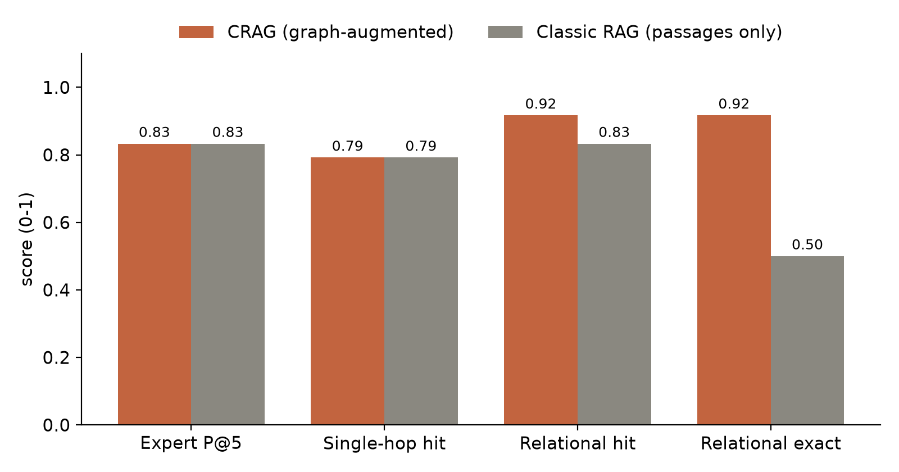
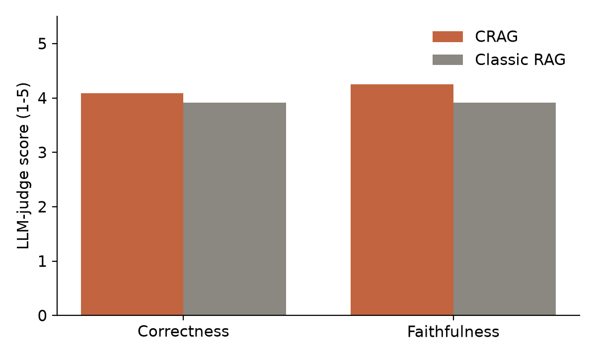
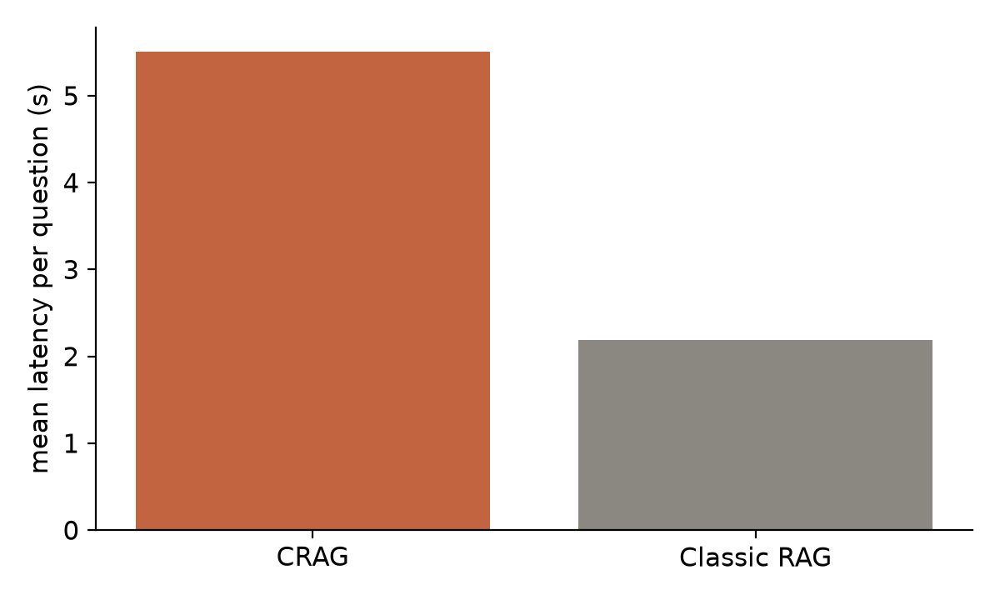

# Evaluation

## Objectives and protocol

The evaluation answers one question: *does graph augmentation make CRAG better than classic RAG?* To isolate the contribution of the graph, the baseline is CRAG itself in passages-only mode: the same chat and embedding models, the same chunks, the same prompts and the same top-*k*, with entity linking, graph expansion, fusion, grading and graph-based ranking switched off. In the baseline, experts are ranked by the best similarity between the question and any passage of their documents, which is the document-centred expert-finding model [26].

The validation corpus contains {{N_DOCS}} anonymised public documents describing professional profiles in six occupational domains, two of them scanned. It was used only to validate the platform. Three benchmarks were built so that their gold labels do not come from the system being evaluated (Table 5.1).

<p class="tcap">Table 5.1: Evaluation benchmarks</p>

| Benchmark | Questions | Gold label | Metrics | What it tests |
|---|---|---|---|---|
| Expert finding | {{N_EXP}} (two per domain), e.g. "Who are the experts in payroll, benefits and employee relations?" | People whose profile belongs to the queried domain | Precision@5 | Identifying experts (O6) |
| Single-hop QA | {{N_SH}}, written by the LLM from one randomly sampled passage, with a reference answer | The document of that passage | Hit rate; correctness and faithfulness (LLM judge, 1–5); latency | Simple lookups, where vector search is expected to be strong |
| Relational QA | {{N_RELQ}}, "Which employee is associated with both X and Y?", where X and Y are graph facts that each match 2–6 people but together exactly one | That person | Exact match (the answer names them); hit rate; latency | Questions that need relations between facts (O4, O5) |

The single-hop benchmark deliberately favours vector retrieval, since each question is written from one passage: it checks that the graph does not degrade simple questions. The relational benchmark targets the situation the graph is designed for. Its questions are built from the graph, which favours CRAG; however, the facts used are stated in the documents, which the baseline retrieves from as well. Precision@5, hit rate and exact match require no judge. Correctness and faithfulness are scored by an LLM judge given the question, the reference answer, the system's answer and all the context the answer could cite [22], [29]; since the judge belongs to the same model family as the system, these two scores are treated as indicative.

## First iteration and failure analysis

The first evaluation run produced the results in the left half of Table 5.2. Before interpreting them, every result that went against expectations was investigated, and four causes were found. Three were flaws of the *evaluation setup*, not of the method:

1. In the baseline, passages were labelled only with a document identifier, so classic RAG could never name the employee a passage describes; its exact match of {{V1_REL_EM_V}} on relational questions measured this omission, not retrieval quality.
2. The judge saw the retrieved passages but not the graph facts, so claims supported by cited facts were scored as unfaithful.
3. Rank fusion sometimes pushed the single most relevant passage out of the six kept, which lowered single-hop hit rate.

The fourth was a flaw of the *design*: the graph signal of expert ranking counted every relation of a person, so people with long documents ranked high for every topic (a degree bias). The fixes were, respectively: label every passage with its document's subject in both modes; give the judge all the context the answer could cite; always keep the three best semantic passages; and count only relations to the question's entities. All benchmarks were then run again. Because these fixes were designed after seeing first-run results on the same questions, the second-run figures are optimistic for CRAG, and both runs are reported.

## Results

<p class="tcap">Table 5.2: Main results (CRAG = graph-augmented; RAG = classic passages-only baseline)</p>

| Metric | Run 1 CRAG | Run 1 RAG | Run 2 CRAG | Run 2 RAG |
|---|---|---|---|---|
| Expert finding, Precision@5 | {{V1_EXP_CRAG}} | {{V1_EXP_BASE}} | {{EXP_CRAG}} | {{EXP_BASE}} |
| Single-hop, hit rate | {{V1_SH_HIT_G}} | {{V1_SH_HIT_V}} | {{SH_HIT_G}} | {{SH_HIT_V}} |
| Single-hop, correctness (1–5) | {{V1_SH_COR_G}} | {{V1_SH_COR_V}} | {{SH_COR_G}} | {{SH_COR_V}} |
| Single-hop, faithfulness (1–5) | {{V1_SH_FAI_G}} | {{V1_SH_FAI_V}} | {{SH_FAI_G}} | {{SH_FAI_V}} |
| Relational, exact match | {{V1_REL_EM_G}} | {{V1_REL_EM_V}} | {{REL_EM_G}} | {{REL_EM_V}} |
| Relational, hit rate | {{V1_REL_HIT_G}} | {{V1_REL_HIT_V}} | {{REL_HIT_G}} | {{REL_HIT_V}} |
| Mean latency, single-hop (s) | {{V1_SH_LAT_G}} | {{V1_SH_LAT_V}} | n/a* | n/a* |
| 95th-percentile latency, single-hop (s) | {{V1_SH_P95_G}} | {{V1_SH_P95_V}} | n/a* | n/a* |

\* Run 2 was executed with deliberate request pacing (2.5 s between model calls) after the API's rate limit was reached, so its latencies measure waiting, not the system; latency is reported from run 1, which ran without pacing. The pipeline changes between runs do not add model calls.

<figure><figcaption>Figure 5.1: Retrieval and identification results, CRAG versus classic RAG (run 2)</figcaption></figure>

<figure><figcaption>Figure 5.2: Answer quality judged by an LLM (run 2, single-hop questions)</figcaption></figure>

<figure><figcaption>Figure 5.3: Mean latency per question (run 1, single-hop questions, unthrottled)</figcaption></figure>

## Discussion

**Relational questions are where the graph pays off.** In the second run, with a baseline that can see whom each passage describes, CRAG names the right employee in {{REL_EM_G}} of relational questions against {{REL_EM_V}} for classic RAG, and retrieves a passage of the right person more often ({{REL_HIT_G}} against {{REL_HIT_V}}). This is the case the project set out to address: each fact alone matches several people, and only their *intersection* identifies one. Vector retrieval returns passages about either fact; the graph, through the coverage signal and the facts linking a person to both entities, points to the person who holds both. The first run shows the same direction even more strongly ({{V1_REL_EM_G}} against {{V1_REL_EM_V}}), but that gap was inflated by the baseline's missing metadata.

**On broad expert queries, the graph adds no measurable precision.** Both systems reach a Precision@5 of {{EXP_CRAG}} and {{EXP_BASE}}. For a topic such as "patient care and clinical services", the semantic similarity of a whole profile is already a strong signal of domain, and the graph mostly re-confirms it. The first run, where CRAG scored {{V1_EXP_CRAG}}, showed that a careless graph signal can even hurt, through degree bias. The value of the graph in expert finding lies in what the precision figure does not measure: the explicit evidence shown for each expert and the ability to combine several requirements.

**On simple questions, the graph does not hurt retrieval and slightly improves judged answers.** Hit rates are equal ({{SH_HIT_G}}), which is the purpose of always keeping the best semantic passages. Judged correctness ({{SH_COR_G}} against {{SH_COR_V}}) and faithfulness ({{SH_FAI_G}} against {{SH_FAI_V}}) favour CRAG slightly; given the judge's limitations and the sample size, this is best read as "no degradation".

**The graph costs time.** CRAG makes two to four more model calls per question (analysis, grading, possibly a retry), so its mean latency was {{SH_LAT_G}} s against {{SH_LAT_V}} s for classic RAG in the unthrottled run. For an interactive assistant this is acceptable but noticeable; caching, a faster grading model and skipping the grading step for high-confidence retrievals would reduce it.

## Threats to validity

- **Small samples.** {{N_EXP}}, {{N_SH}} and {{N_RELQ}} questions show directions, not statistically established effects. Only the relational difference is large.
- **Tuning on the test questions.** The second-run fixes were designed after seeing first-run results on the same questions, so second-run figures are optimistic for CRAG. A fresh question set is needed to confirm them.
- **Benchmark construction.** Relational questions are generated from the graph, which favours the graph-based system, even though the underlying facts are present in the text.
- **Corpus.** Public profile documents are a proxy for company documents; procedures and reports have different structures.
- **Judge.** The judge model belongs to the same family as the system; correctness and faithfulness are indicative only.
- **Extraction quality** was not measured directly against hand-labelled data.

# General conclusion

This project set out to build an intelligent knowledge-management platform that combines a knowledge graph with a large language model, and to verify whether the graph makes it better than classic RAG.

**Contributions.** CRAG implements every capability requested by the brief. It ingests documents, reading scanned ones with OCR; it extracts entities and typed relations with an LLM, validated in code; it stores them with passage and entity embeddings in a single Neo4j database, or in a portable snapshot; and it answers questions with a LangGraph workflow that fuses semantic and graph retrieval, grades its evidence and retries once, ranks experts and recommends documents, and generates answers that cite both passages and graph facts, from which a faithful explanation is derived and drawn. The platform is tested, secured, containerised and publicly deployed, and every step is documented.

**Findings.** Measured against a baseline that differs only by the graph, CRAG answers relational questions markedly better ({{REL_EM_G}} against {{REL_EM_V}} exact match), matches classic RAG on broad expert queries and simple lookups, and is slower. The evaluation process itself was a result: the first run exposed three flaws in the evaluation and one design flaw, and correcting them changed the conclusions. The answer to the research question is therefore qualified: a knowledge graph does not improve every question, but it brings large gains where answers depend on relations between facts, and it makes answers explainable. In that setting, it is worth its cost.

**Perspectives.** The next steps are, in order of value: a pilot on real company documents with access control and self-hosted models; measured and improved extraction (a fixed ontology, synonym merging, provenance on every fact); stronger retrieval (lexical search as a third ranking, re-ranking, Personalised PageRank, text-to-Cypher for counting questions); and a larger, human-labelled evaluation with ablations. Thirty-seven concrete improvements are listed in the project's OTHER_IDEAS document.

# References

[1] A. Vaswani et al., "Attention is all you need," in *Advances in Neural Information Processing Systems (NeurIPS)*, 2017.

[2] P. Lewis et al., "Retrieval-augmented generation for knowledge-intensive NLP tasks," in *NeurIPS*, 2020.

[3] Y. Gao et al., "Retrieval-augmented generation for large language models: A survey," arXiv:2312.10997, 2023.

[4] V. Karpukhin et al., "Dense passage retrieval for open-domain question answering," in *Proc. EMNLP*, 2020.

[5] N. Reimers and I. Gurevych, "Sentence-BERT: Sentence embeddings using Siamese BERT-networks," in *Proc. EMNLP-IJCNLP*, 2019.

[6] L. Wang et al., "Text embeddings by weakly-supervised contrastive pre-training," arXiv:2212.03533, 2022.

[7] C. Lee et al., "NV-Embed: Improved techniques for training LLMs as generalist embedding models," in *Proc. ICLR*, 2025.

[8] A. Hogan et al., "Knowledge graphs," *ACM Computing Surveys*, vol. 54, no. 4, 2021.

[9] S. Pan, L. Luo, Y. Wang, C. Chen, J. Wang and X. Wu, "Unifying large language models and knowledge graphs: A roadmap," *IEEE Trans. Knowledge and Data Engineering*, vol. 36, no. 7, 2024.

[10] Y. Zhu et al., "LLMs for knowledge graph construction and reasoning: Recent capabilities and future opportunities," *World Wide Web*, vol. 27, 2024.

[11] D. Edge et al., "From local to global: A graph RAG approach to query-focused summarization," arXiv:2404.16130, 2024.

[12] B. Peng et al., "Graph retrieval-augmented generation: A survey," arXiv:2408.08921, 2024.

[13] Z. Guo, L. Xia, Y. Yu, T. Ao and C. Huang, "LightRAG: Simple and fast retrieval-augmented generation," arXiv:2410.05779, 2024.

[14] B. Jiménez Gutiérrez, Y. Shu, Y. Gu, M. Yasunaga and Y. Su, "HippoRAG: Neurobiologically inspired long-term memory for large language models," in *NeurIPS*, 2024.

[15] X. He et al., "G-Retriever: Retrieval-augmented generation for textual graph understanding and question answering," in *NeurIPS*, 2024.

[16] J. Sun et al., "Think-on-Graph: Deep and responsible reasoning of large language model on knowledge graph," in *Proc. ICLR*, 2024.

[17] S.-Q. Yan, J.-C. Gu, Y. Zhu and Z.-H. Ling, "Corrective retrieval augmented generation," arXiv:2401.15884, 2024.

[18] A. Asai, Z. Wu, Y. Wang, A. Sil and H. Hajishirzi, "Self-RAG: Learning to retrieve, generate, and critique through self-reflection," in *Proc. ICLR*, 2024.

[19] S. Yao et al., "ReAct: Synergizing reasoning and acting in language models," in *Proc. ICLR*, 2023.

[20] J. Wei et al., "Chain-of-thought prompting elicits reasoning in large language models," in *NeurIPS*, 2022.

[21] N. F. Liu et al., "Lost in the middle: How language models use long contexts," *Trans. Association for Computational Linguistics*, vol. 12, 2024.

[22] S. Es, J. James, L. Espinosa-Anke and S. Schockaert, "RAGAS: Automated evaluation of retrieval augmented generation," in *Proc. EACL (System Demonstrations)*, 2024.

[23] G. V. Cormack, C. L. A. Clarke and S. Büttcher, "Reciprocal rank fusion outperforms Condorcet and individual rank learning methods," in *Proc. ACM SIGIR*, 2009.

[24] Y. A. Malkov and D. A. Yashunin, "Efficient and robust approximate nearest neighbor search using hierarchical navigable small world graphs," *IEEE Trans. Pattern Analysis and Machine Intelligence*, vol. 42, no. 4, 2020.

[25] I. Robinson, J. Webber and E. Eifrem, *Graph Databases*, 2nd ed. O'Reilly Media, 2015.

[26] K. Balog, L. Azzopardi and M. de Rijke, "Formal models for expert finding in enterprise corpora," in *Proc. ACM SIGIR*, 2006.

[27] R. Smith, "An overview of the Tesseract OCR engine," in *Proc. ICDAR*, 2007.

[28] I. Nonaka and H. Takeuchi, *The Knowledge-Creating Company*. Oxford University Press, 1995.

[29] L. Zheng et al., "Judging LLM-as-a-judge with MT-Bench and Chatbot Arena," in *NeurIPS (Datasets and Benchmarks)*, 2023.

[30] LangChain, "LangGraph documentation," 2025. [Online]. Available: https://langchain-ai.github.io/langgraph/

[31] NVIDIA, "NVIDIA NIM API reference," 2026. [Online]. Available: https://docs.api.nvidia.com/

[32] A. Wiggins, "The twelve-factor app," 2011. [Online]. Available: https://12factor.net/

# Appendix A: Using the platform

**Installation and use.** See the repository README: create a virtual environment, install `requirements-dev.txt`, copy `.env.example` to `.env` with the NVIDIA API key, ingest a folder with `python scripts/ingest.py <folder>`, and serve with `uvicorn crag.api:app`. The production stack starts with `docker compose up -d`.

**Example request.**

```
POST /api/ask
{"question": "Which employees know AutoCAD and project scheduling?", "mode": "graph"}
```

The response contains `answer`, `sources` (passages with their origin: vector, graph or both), `facts`, `graph` (the neighbourhood), `experts` (with their three signals, covered entities and cited evidence), `recommendations`, `explanation` (seed entities, cited reasoning path, retries) and `trace` (one entry per workflow step).
